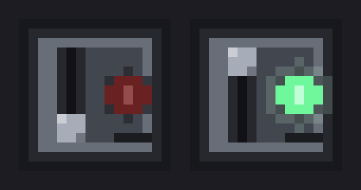

# AstraNautics

Minecraft **1.20.1 / Forge 47.x** 向けの MOD です。

- Mod ID: `astranautics`
- Version: `3.5.6`
- Minecraft: `1.20.1`（`[1.20.1,1.21)`）
- Forge: `47.x`（`[47,)`）
- Java: 17

## 収録ブロック



左から: 物理トグルスイッチ（OFF / ON）。

### 物理トグルスイッチ（Physics Toggle Switch / `astranautics:physics_switch`）

この MOD の**唯一のブロック**です。設置したスイッチに繋がっているブロック構造を
**剛体として切り離し、物理演算で動かします**（Create: Aeronautics / Valkyrien Skies 系）。

- **右クリック**で物理演算 ON。スイッチに繋がっているブロック群を半径
  `assemblyRadius`（既定 10）以内で BFS 探索し、1 つの剛体（`PhysicsShip`）として
  ワールドから切り離します。
- **物理演算できるブロックはすべて対象**です。岩盤・コマンドブロック・チェストなど、
  クリエイティブ専用ブロックや BlockEntity を持つブロックも剛体になります
  （空気、当たり判定の無いブロック（草花・たいまつ・流体）だけが対象外）。
- **スイッチ自身も構造物の一部**になります。組み立てるとスイッチはワールドから消え、
  船体のブロックとして一緒に動きます（置き去りにならない）。
- 切り離された構造物は質量・慣性テンソルを持ち、重力・摩擦・反発・回転を伴って
  落下・滑走・衝突します。
- **左クリック（短く）で叩くと動きます**。当たった位置に撃力がかかるので、端を叩けば
  回転しながら**転がります**（`physics.punchSpeed` で強さを調整）。
- **左クリック長押しでブロックを壊せます**（バニラのサバイバルと同じ）。硬さ・適正ツール・
  効率までバニラの計算式どおりで、進捗はブロックごとに保持されます。**クリエイティブでは一瞬**です。
  壊したブロックはドロップし、チェストなら中身もドロップします。
- **ブロックを持って右クリック**すると、狙った面の外側にそのブロックが**増築**され、
  剛体の一部になります（質量・慣性も再計算、位置はその場を維持）。
- **チェスト / 樽 / シュルカーボックス**は、素手で右クリックするとそのまま**開けます**
  （中身は船と一緒に保存され、解除時は中身ごと元に戻ります）。
- **物理化を解除するには、スイッチをもう一度設置して ON にします**。船体の隣に
  物理トグルスイッチを置いて右クリックすると、その船体がその場でブロックに戻り、
  スイッチは自動で **OFF** に戻ります（何度でも解除できます）。
  船体を素手で右クリックしても解除されません（メッセージが出るだけ）。
- **素手で右クリック**すると、ブロック数・質量・速度をチャットに表示します。
- 船体には**当たり判定**があり、プレイヤーや Mob はすり抜けず、**普通のブロックのように上に立てます**。
  めり込み・振動を抑えるため、クライアント側でも同じ衝突解決を行っています。

#### 使い方

1. 物理トグルスイッチを、物理演算したい構造物に**接触**させて置く（地面には付けない）。
2. スイッチを**右クリック** → その場で組み立てが走り、結果がチャットに出る。
   - 成功: `物理演算 ON — N ブロックを剛体にしました（叩くと動きます）`
   - 失敗: 理由が表示される（状態は ON のまま維持され、60 tick 後に再試行）
3. 構造物を**短く左クリック**すると、その方向へ動いたり転がったりします。
4. **左クリックを長押し**すると、狙ったブロックがバニラと同じ速さで壊れます
   （クリエイティブは一瞬。長押し中は船体を押しません）。
5. ブロックを持って**右クリック**すると、その面に増築できます（何度でも）。
6. 解除したいときは、船体の隣に**スイッチを置いて右クリック**します
   （船体がブロックに戻り、スイッチは OFF に戻ります）。
7. チェスト・樽・シュルカーボックスは**素手で右クリックで開けます**。

> **v3.2.0 で物理アセンブラ（`physics_assembler`）を削除しました。**
> 既存ワールドのアセンブラは、読み込み時に自動で物理スイッチへ置き換わります
> （`LegacyMappings` / RegistryEvent.MissingMappings）。

## 物理演算エンジン

詳細は [docs/PHYSICS.md](docs/PHYSICS.md) を参照してください。概要:

| 要素 | 実装 |
|---|---|
| 剛体 | 位置・姿勢クォータニオン・線形/角速度、6 DOF |
| 質量特性 | ブロック硬さベースの質量 + 平行軸の定理による慣性テンソル |
| 衝突 | 表面ボクセル OBB × ワールドブロック AABB の **SAT（15軸）** |
| 求解 | 逐次インパルス法（累積インパルス + クランプ、クーロン摩擦、Baumgarte 補正） |
| 積分 | 半陰的オイラー、1 tick あたり可変サブステップ（高速時は自動で増加） |
| 同期 | 位置=バニラ同期 / 姿勢=SynchedEntityData(FLOAT×4) / 構造=Base64文字列（スポーン時は `IEntityAdditionalSpawnData` でも送信） |
| 描画 | `PhysicsShipRenderer` がクォータニオンを適用し表面ボクセルを描画 |
| 当たり判定 | 構造の回転後 AABB を実寸で確保（1×1×1 ではない） |
| 保存 | 構造と剛体状態をエンティティ NBT に保存 |
| 船 vs 船 | 空間インデックス近傍の OBB 衝突 + 2体ソルバ（1 tick 1回） |
| 船 vs エンティティ | 押し出し + 上面では乗って移動（1 tick 1回） |
| プレイヤーの撃力 | 左クリック（短く）で表面ボクセルに `applyImpulseAt`（線形 + 回転 = 転がる）。直後に長押し採掘へ移行した場合は撃力を打ち消す |
| 物理化解除 | 船体の隣にスイッチを置いて ON（`PhysicsSwitchBlockEntity#apply` が近傍の船体を溶解し、スイッチは OFF に戻る） |
| 増築 / 取り外し | 右クリック＝面の外側セルを追加、左クリック長押し＝バニラ準拠の採掘でセルを回収（`MineTick` パケットで進捗を送信、クリエイティブは即時） |
| ブロックエンティティ | 各ボクセルの NBT（チェストの中身など）を船と一緒に保存・復元。船上のチェストは開ける |
| エンティティ衝突 | 表面ボクセル OBB × エンティティ AABB。支持 / 天井 / 壁を分けて解決し、支持時は水平速度を保つ（1 tick 最大 3 パス、サーバー + クライアント） |
| 軽量化 | ウォームスタート / スリープ / 表面ボクセルのみ / クエリのメモ化 / 可変サブステップ |

### 検証（GitHub Actions 上のユニットテスト）

`src/test/java/com/astranautics/physics/` に物理コアのテストがあり、
`./gradlew test` で CI 上で実行されています（合成ボクセルワールドでの実シミュレーション）。

- 立方体が床の上で静止する（sink/float しない）
- 高速落下でも床を突き抜けない
- 壁に衝突して停止する
- 角から落ちると落下する
- 運動学的（OFF）ボディは動かない
- 貫通時の法線・深さ（SAT）、点速度・角運動量・クォータニオン正規化

## レシピ

**物理トグルスイッチ**（1 個）

```
レバー
レッドストーン
石
```

## ダウンロード

ビルド済み jar は Releases に置いてあります。

- jar を `.minecraft/mods/` に入れて Forge 1.20.1 で起動してください。
- 起動ログに `AstraNautics loaded (Minecraft 1.20.1 / Forge)` が出れば読み込み成功です。

## ソース構成

```
build.gradle                  ForgeGradle 6 ビルドスクリプト
gradle.properties             MC / Forge / Mod の各種バージョン
settings.gradle
src/main/java/com/astranautics/
    AstraNautics.java                 @Mod エントリポイント
    ModCreativeTabs.java              専用クリエイティブタブ
    LegacyMappings.java               旧ブロック → スイッチの自動移行
    block/ModBlocks.java              ブロック登録
    block/PhysicsSwitchBlock.java     物理トグルスイッチ（唯一の制御ブロック）
    block/entity/ModBlockEntities.java
    block/entity/PhysicsSwitchBlockEntity.java   ON/OFF・船のリンク・再試行
    block/entity/ShipAssembler.java   構造物の切り離し（BFS）
    command/AstraCommands.java        /astranautics diag
    entity/PhysicsShip.java           物理演算される構造物エンティティ
    entity/ModEntities.java           エンティティ登録
    physics/RigidBody.java            剛体（質量・慣性・力積）
    physics/ShipStructure.java        ボクセル構造と質量特性
    physics/CollisionDetector.java    衝突検出
    physics/Obb.java                  OBB / SAT
    physics/ShipPhysics.java          逐次インパルスソルバ
    physics/BlockCollisionSource.java 衝突形状の供給元（テスト可能）
    physics/LevelCollisionSource.java 実ワールド版
    physics/ShipStructureCodec.java   構造のシリアライズ
    client/PhysicsShipRenderer.java   船の描画
    client/AstraClientEvents.java     クライアント登録
    config/AstraConfig.java           共通コンフィグ
    item/ModItems.java                ブロックアイテム登録
src/main/resources/META-INF/mods.toml
src/main/resources/assets/astranautics/...   モデル / テクスチャ / 言語ファイル
src/main/resources/data/astranautics/...     ルートテーブル / レシピ
tools/gen_textures.py         ブロックテクスチャ(16x16 PNG)生成スクリプト
tools/build_jar.py            ForgeGradle 無しで最小 jar を作るフォールバック
```

## ビルド

```bash
./gradlew build
# => build/libs/astranautics-3.1.1.jar
```

開発用クライアント起動:

```bash
./gradlew runClient
```

テクスチャを作り直す場合:

```bash
python3 tools/gen_textures.py
```

### GitHub Actions

- `.github/workflows/build.yml` — push / PR ごとにコンパイルとリソース JSON 検証
- `.github/workflows/release.yml` — タグ push または手動実行で jar をビルドし Release に添付

## 軽量化のポイント

| 手法 | 内容 |
|---|---|
| ウォームスタート | 前ステップの接触インパルスを引き継ぎ、ソルバ反復 8 → 4 でも同精度 |
| スリープ | 静止した船（既定 40 tick）は物理計算を完全にスキップ。近接物体で自動起床 |
| 空間インデックス | 表面ボクセルを 2 ブロック格子に索引化し、船同士・エンティティ・描画の判定を高速化 |
| クエリのメモ化 | 1 ステップ内のワールドブロック参照をキャッシュ |
| 表面のみ | 衝突・描画とも内部ボクセルを除外（コストは体積ではなく表面積に比例） |
| 可変サブステップ | 速度に応じてだけ分割数を増やす |

## トラブルシューティング

| 症状 | 原因 / 対処 |
|---|---|
| 組み立てた瞬間にゲームが落ちる（v3.1.0） | 船のバウンディングボックスがコンストラクタ実行前に参照されていたため。**v3.1.1 で修正** |
| アセンブラが無い / クラフトできない | v3.2.0 で削除しました。**スイッチ 1 個だけ**で物理化できます |
| スイッチを押しても何も起きない | Shift + 右クリックで状態確認（対象ブロック数・失敗理由）。スイッチに**接して**ブロックを置く必要があります |
| 叩いても動かない | v3.2.0 以降で対応。`physics.punchSpeed`（既定 2.5）を上げるとよく動きます |
| スイッチが無い / 消えた | v3.3.0 からスイッチも構造物の一部になります。解除するときは船体の隣に**スイッチを置いて右クリック**（船体がブロックに戻り、スイッチは OFF）。状態だけ見たいときは素手で右クリック |
| 船の上にブロックを置きたい | ブロックを持って船体を**右クリック**すると増築されます（ワールドには置かれません） |
| 逆さま（下面が上）にした船の上でガクガクする | v3.5.4 で天井（下向き）の接触を壁と同じ計算にしました。頭上に船体がある場所（船内・張り出しの下）で揺れる場合は `collisions.shipVsEntity` を確認 |
| 甲板の上で進んだり止まったりする | v3.5.3 で修正（足元の浅い重なりを壁として扱っていた＋1 tick ぶん沈んでいた）。`collisions.shipVsEntity` が `true` か確認 |
| 世界全体が小刻みに揺れる | v3.5.6 で修正（足元を前 tick の解決高さにピン留めし、tick 開始＝終了の位置に）。残る場合は他 MOD（視点エフェクト系）との競合を疑ってください |
| 乗ると視点が小刻みに上下する | v3.5.5 で修正（接地判定が 1 tick おきに外れて重力キャンセルが ON/OFF していた）。アップデート後に再現する場合は `collisions.shipVsEntity` と他 MOD の視点エフェクトを確認 |
| 船に乗るとすり抜ける / ガクガクする | v3.5.2 でクライアント側の解決をプレイヤーの tick 後に移しました（v3.5.1 の支持/壁/天井の分割と併せて）。`collisions.shipVsEntity` が `true` か確認してください |
| 船の上を歩くと遅い | v3.5.1 で修正（支持接触がプレイヤーの水平速度を上書きしていた）。まだ遅い場合は `physics.friction` ではなく衝突解決が原因なのでログを確認 |
| 船上のチェストを開けない | v3.4.0 以降は素手で右クリックで開けます（ブロックを持っていると増築になります） |
| スイッチを押すと青く光ってすぐ消える（v3.0.0 まで） | アセンブルに失敗したときにブロック状態を即 OFF に戻していたため。**v3.1.0 で修正**し、失敗時は ON を維持して理由をチャット・ログに出すようにしました |
| スイッチを ON にしても何も起きない | Shift + 右クリックで状態を確認。`対象ブロック -`／失敗理由が出ます。ログの `[astranautics]` 行にも詳細が出ます |
| 地面ごと巻き込まれて穴が空く | スイッチが地形に接触していると、繋がっている地形も構造物として切り離されます。スイッチは地面から離して置くか、`assemblyRadius` / `maxBlocks` を小さくしてください |
| 船が見えない | v3.1.0 でスポーンパケットに構造を含めるよう修正（後から近づいたプレイヤーにも表示されます） |
| 何ブロック拾ったか知りたい | 素手で右クリック（状態表示）、または `/astranautics diag` |
| ブロックを壊したい | **左クリック長押し**（バニラと同じ速さ、クリエイティブは一瞬）。短くクリックすると叩いて動かす方になります |
| 物理化を解除したい | 船体の隣に**スイッチを置いて右クリック**。船体がブロックに戻り、スイッチは OFF に戻ります |

## 既知の制限

`docs/PHYSICS.md` の「既知の制限」に詳細があります。要点:

- 浮力・空気抵抗・推力（プロペラ）などの空気力学は未実装（Phase 3 候補）
- 物理はサーバースレッドで計算（船単位の並列化は未着手）
- 船上でのブロック操作・レッドストーン・インベントリは未対応
- エンティティは運動学的（プレイヤーが船を押し返すことはできない）

## 変更履歴

- **v3.5.6** — **世界全体が揺れるのを修正**。重力キャンセル方式だと丸め誤差ぶんの残留沈み込みが
  毎 tick 補正され、カメラが数ミリ動いていました。**足元 Y を前 tick の解決結果にピン留め**する方式に
  変更し、tick 開始と終了の位置を一致させて描画補間の移動量を 0 に。クライアントの衝突解決も
  レベル全体の走査から `ShipWorld` の船リスト（次元ごと）に変更
- **v3.5.5** — **視点が上下する（10 Hz の上下動）を修正**。接地判定が「重なり > 0」だけ
  だったため、ちょうど乗っている状態では支持が 1 tick おきに失われ、重力キャンセルが
  ON/OFF していました。足元を 0.06 ブロック下へ伸ばした**プローブ箱**で接地を判定するようにし、
  分離時の上方向バイアスも 0.004 → 0.001 に下げてカメラの這い上がりを防止
- **v3.5.4** — **下向き（天井・逆さまにした船）の接触を壁と同じ計算方法に**。頭を 0.12 ブロック
  切り落とした箱で判定して浅い接触では押し下げない／支持と天井が同時なら支持を優先。
  あわせて支持の記録を毎 tick 確実に行い（分離量 0 でも記録）、支持の高さが 0.08 以上
  ずれたら無効化（段差を下りるときの 1 tick の浮きを防止）
- **v3.5.3** — **甲板の上で「進む→止まる」を繰り返す問題を修正**。立っているあいだ
  1 tick ぶん沈んだ足元が隣の甲板ブロックと浅く重なり、SAT が水平軸を選んで
  「押し戻し＋速度除去」になっていたのが原因。壁判定を**足元 0.12 ブロック切り落とし**で
  行うようにし、さらに `ShipPlatformSupport` が立っているプレイヤーの縦速度を
  1 tick ぶんの重力に置き換えて**沈み込み自体を無くしました**（補正ゼロで歩けます）
- **v3.5.2** — **甲板に立ったときの揺れを修正**。クライアント側の衝突解決を
  「船エンティティの tick 内」から `ClientTickEvent.END`（プレイヤーの tick が終わった後）へ移動。
  船の tick がプレイヤーより先に来ると補正 → 重力で 0.08 沈む、を毎 tick 繰り返して
  見た目が揺れていました。あわせて速度変化 0.1 未満では `hurtMarked`（モーションパケット）を
  送らないようにし、クライアント側の補正対象をローカルプレイヤーだけに限定
- **v3.5.1** — **船の上を歩く速度とガクガクを修正**。支持接触でプレイヤーの水平速度を
  甲板の速度で上書きしていたのをやめ（＝歩くのが極端に遅かった原因）、補正を
  貫通深さベースに変更（傾いた船体でも座標が飛ばない）。毎 tick の
  `connection.teleport` / `hurtMarked` をやめて 0.4 ブロック未満の補正はパケット無しに。
  船はこの処理では起こさないので、静止した船の上は安定します
- **v3.5.0** — **ブロック破壊をバニラ準拠に**: 左クリック長押しで硬さ・適正ツールに応じた速さで
  壊れ、クリエイティブは一瞬（`MineTick` パケットで進捗を送信）。短い左クリックは従来どおり
  **叩いて動かす**（長押しに移行したら撃力は打ち消し）。**物理化解除は「スイッチをもう一度設置して
  ON」**に変更（船体を素手で右クリックしても解除されません）
- **v3.4.0** — **ブロックを外せる**ように（Shift+左クリック、チェストは中身ごと回収）、
  **船上のチェスト/樽/シュルカーボックスを開ける**ように（ブロックエンティティの NBT を船と一緒に保存）、
  **スイッチを壊しても物理演算が続く**ように変更、**当たり判定をクライアント側でも解決**して
  上に立ったときの振動を解消
- **v3.3.1** — 解除の操作を変更: 船体を**素手で右クリック＝スイッチ OFF** で物理化解除。
  戻ったスイッチは OFF 状態で復元され、すぐ組み立て直せます（Shift + 右クリックは状態表示）
- **v3.3.0** — **スイッチも構造物の一部に**（置き去りにしない）、**後からブロックを増築**できる
  （右クリックで剛体に追加、質量・慣性を再計算）、**船体の当たり判定を強化**（エンティティを
  1 tick 4 パスで押し出し、上に乗れる）。解除は船体を素手で右クリック（スイッチ OFF）
- **v3.2.0** — **物理アセンブラを削除し、物理トグルスイッチだけで物理化できるように**。
  スイッチがブロックエンティティを持ち、ON/OFF・再試行・状態表示を担当。**叩くと動く／転がる**
  プレイヤー撃力（Phase 3）を追加。既存ワールドのアセンブラは自動でスイッチへ移行
- **v3.1.1** — 組み立て時のクラッシュ（`NullPointerException: halfExtents`）を修正。
  船の当たり判定の初期化順の問題で、ブロックエンティティ tick 中の例外がサーバーを落としていました。
  併せて、物理 tick・組み立て・復元の各処理に例外ガードを追加（今後は該当の船だけを停止してログに残し、
  ワールドは落ちません）。失敗理由の日本語化も実施
- **v3.1.0** — 全ブロック（岩盤・BlockEntity 持ち含む）を物理演算対象に、
  アセンブル失敗時の点滅を修正（ON 維持 + 理由表示）、スイッチ／右クリックでの即時実行と結果表示、
  船の実寸 AABB、スポーン時の構造同期、テクスチャ刷新、`/astranautics diag`
- **v3.0.0** — ブロックを `physics_assembler` / `physics_switch` に改名（= 物理アセンブラ）、
  船 vs 船 / 船 vs エンティティ衝突、スリープ、ウォームスタートなどの軽量化
- **v2.0.0** — 剛体物理エンジン実装
- **v1.1.0** — アセンブラ前身 + トグルスイッチ（エンティティ引力方式）
- **v1.0.0** — 読み込み確認用の最小 MOD

## ライセンス

MIT
